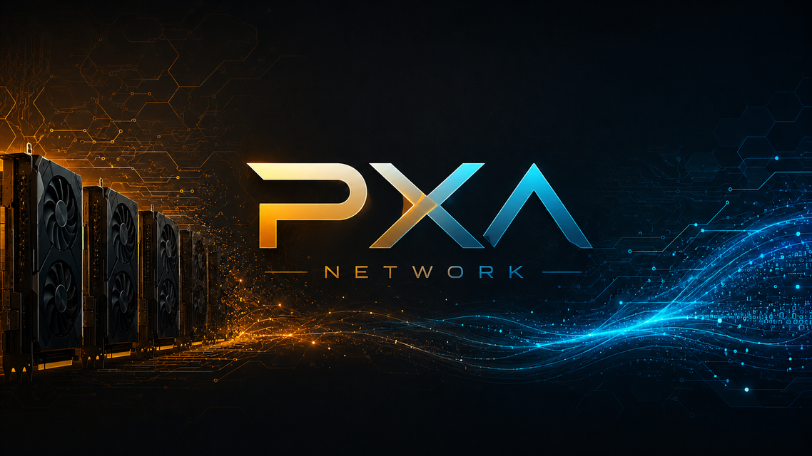

# PXA 4.0

Released October 30, 2026.

PXA is a free inference engine for older datacenter cards, the Tesla P100 and V100, and for Pascal cards such as the GTX 1080 Ti. In every comparison below, 4.0 is ahead of v3.1 and of mainline llama.cpp on the same machine, on every prompt class we measured. 4.0 adds the Nemotron families and GLM-5.3-Flash, runs the Qwen3.6 35B-A3B mixture-of-experts model with its MTP block, makes Flash-Next with Overdrive several times faster on one V100, rebuilds PXA Control, and adds Docker, Windows and macOS builds. The numbers come first, then what changed.

## Downloads

| Platform | File | sha256 |
|---|---|---|
| Linux x86_64 (CUDA 12.8, native code for sm_60, 61, 70, 75, 80, 86, 89) | `pxa-v4.0.0-linux-x86_64-cuda12.8-sm60_61_70_75_80_86_89.tar.gz` | `7134659cf086e1ed7b8c3133fd637185e98e9dbd8231c97c90fa6fbde9c757a0` |
| Docker image (Linux, NVIDIA runtime) | `docker pull ghcr.io/poisonxa16/pxa:v4.0` | image id `16c998a6784c6d6ac62be3b49c8c50d95d8ba967b629c46b80273d02673a8e8c` |
| Windows x64: PXA Control (unsigned, see "Windows" below) | `pxa-control-win64.exe` | `bc72dbd029bc7752f60de4d74b119e28ecd277c6591de017d1bca13eac27116e` |
| Windows x64: the engine (unsigned, see "Windows" below) | `pxa-engine-win64-cuda12.zip` | `f10319975ffd968aa4daa68ed90519f000c23cb5143ae90220fc23cc06911d8f` |
| macOS: PXA Control, native on Intel and Apple silicon (unsigned, see "macOS" below) | `pxa-control-v4.0.0-macos-universal2.zip` | `5bf889cfe7ed94c710ac95c5a9b3a1f0a15f875e6fb6a3120b5183aa43267311` |

The Docker tag `latest` moves with the public release, as it did for 3.1; `v4.0` is fixed. An Android client app is in testing and is not part of the 4.0 downloads.

Check the sha256 before you unpack: `sha256sum -c <file>.sha256` on Linux, the `SHA256SUMS` file next to the Windows downloads, `shasum -a 256 <file>` on macOS. Every release package passes a clean-package scan before it is published.

## The numbers

Tokens per second. Decode rows are greedy, 512 generated tokens, on three prompt classes (prose / code / chat). Every 4.0 figure was measured on this release build. The v3.1 and mainline llama.cpp figures were measured on the same machine, the same card type and the same prompts, in the session where each row was first confirmed ahead. v3.1 runs our own model file; mainline llama.cpp cannot load PXQ or PXQN files, so it runs a standard llama.cpp file of the same model (Q4_0, Q4_K_M, IQ4_XS or similar), and the mainline column gives its fastest result. The machine often had other work running, so absolute speeds are lower bounds. A dash means that engine was not part of that comparison.

**Decode: Qwen3.8 27B**

| Setup | v3.1 | mainline llama.cpp | 4.0 | 4.0 vs v3.1 |
|---|---:|---:|---:|---:|
| one V100, MTP | 61.1 / 66.3 / 55.6 | 54.2 / 64.1 / 52.4 | 74.1 / 93.8 / 64.0 | +21.3% / +41.3% / +15.2% |
| one V100, no speculation | 39.2 / 39.2 / 39.2 | 36.9 / 36.8 / 36.9 | 41.1 / 41.0 / 41.2 | +4.7% / +4.5% / +5.1% |
| two V100 (NVLink), tensor split, MTP | 70.8 / 94.5 / 61.1 | 54.1 / 63.4 / 49.2 | 79.5 / 107.0 / 75.5 | +12.3% / +13.3% / +23.7% |
| one P100, no speculation | 25.2 / 25.2 / 25.2 | 14.9 / 14.9 / 14.9 | 27.5 / 27.4 / 27.4 | +8.9% / +9.0% / +8.7% |
| two P100, tensor split, MTP | 49.6 / 62.0 / 42.5 | - | 52.9 / 67.9 / 47.1 | +6.7% / +9.4% / +10.7% |
| two P100, tensor split, no speculation | 36.1 / 36.1 / 36.3 | - | 39.8 / 39.9 / 39.9 | +10.2% / +10.4% / +9.9% |
| four P100 | 27.0 / 27.6 / 25.5 | - | 44.3 / 44.3 / 44.3 | +64.1% / +60.4% / +73.7% |

**Decode: mixture-of-experts models**

| Setup | v3.1 | mainline llama.cpp | 4.0 | 4.0 vs v3.1 |
|---|---:|---:|---:|---:|
| Qwen3.6 35B-A3B, two P100, tensor split, MTP | 89.9 / 110.8 / 81.5 | - | 159.1 / 186.6 / 153.2 | +77.0% / +68.4% / +88.1% |
| Qwen3.6 35B-A3B, two P100, no speculation | 73.5 / 73.7 / 73.6 | - | 139.2 / 139.2 / 139.3 | +89.5% / +88.8% / +89.4% |
| Qwen3.6 35B-A3B, one V100, no speculation | 61.7 / 63.7 / 59.7 | 35.8 / 36.5 / 35.8 | 86.8 / 82.6 / 80.8 | +40.7% / +29.8% / +35.3% |
| Flash-Next (PXQN file), one V100 with experts in host RAM, Overdrive, MTP | 10.8 / 12.4 / 16.7 | 10.2 / 11.5 / 10.6 | 58.6 / 57.8 / 58.8 | +441.8% / +367.0% / +251.8% |
| Flash-Next (PXQN file), two V100, Overdrive, MTP | 52.9 / 59.4 / 58.5 | 10.7 / 10.5 / 10.3 | 91.7 / 113.4 / 116.2 | +73.3% / +90.8% / +98.6% |
| Flash-Next (PXQN file), two P100, MTP | 35.9 / 39.6 / 46.5 | - | 47.1 / 52.5 / 55.1 | +31.1% / +32.5% / +18.3% |
| Gemma 4 26B-A4B (PXQN4 file), one V100 | 119.0 / 119.0 / 119.0 | 90.2 / 90.4 / 90.5 | 132.0 / 132.2 / 132.2 | +10.9% / +11.1% / +11.1% |
| Gemma 4 26B-A4B (PXQN4 file), one P100 | 67.6 / 67.9 / 67.6 | - | 78.0 / 79.9 / 80.1 | +15.5% / +17.7% / +18.4% |
| Llama-3.1-Nemotron-Nano 8B, one V100 | 114.4 / 113.9 / 114.3 | 105.6 / 106.0 / 105.8 | 131.3 / 130.9 / 131.1 | +14.8% / +14.9% / +14.7% |

**Prompt processing**

| Setup | v3.1 | mainline llama.cpp | 4.0 | 4.0 vs v3.1 |
|---|---:|---:|---:|---:|
| Qwen3.8 27B, one V100, 4k prompt | 956.7 | 802.1 | 1124.4 | +17.5% |
| Qwen3.8 27B, one V100, 16k prompt | 875.1 | 722.8 | 996.8 | +13.9% |
| Qwen3.6 35B-A3B, two P100, 512 prompt | 1193.0 | - | 1314.4 | +10.2% |
| Qwen3.6 35B-A3B, two P100, 4096 prompt | 1763.3 | - | 1920.0 | +8.9% |
| Qwen3.6 35B-A3B, two P100, 16384 prompt | 1652.1 | - | 1991.5 | +20.5% |
| Flash-Next, one V100 with experts in host RAM, 8k prompt | 346.0 | 73.3 | 537.2 | +55.3% |
| Flash-Next, one V100 with experts in host RAM, 28k prompt | 375.4 | 82.9 | 639.0 | +70.2% |
| Flash-Next, two P100, about 8k prompt | 252.8 | - | 322.5 | +27.6% |
| Flash-Next, two P100, about 16k prompt | 245.2 | - | 313.5 | +27.8% |
| Flash-Next, two P100, about 30k prompt | 219.0 | - | 288.5 | +31.8% |
| Gemma 4 26B-A4B (PXQN4 file), one V100, 4k prompt | 1782.1 | 1301.3 | 4315.6 | +142.2% |
| Gemma 4 26B-A4B (PXQN4 file), one V100, 8k prompt | 1776.1 | 1248.0 | 4111.8 | +131.5% |
| Gemma 4 26B-A4B (PXQN4 file), one V100, 16k prompt | 1642.3 | 1232.9 | 3686.0 | +124.4% |
| Gemma 4 26B-A4B (PXQN4 file), one V100, 64k prompt, 8-bit KV cache | 1107.4 | - | 2387.7 | +115.6% |

The Flash-Next two-P100 prompt rows are derived from the time to the first token.

**Models without a v3.1 comparison** (4.0 on our PXQ or PXQN file against mainline llama.cpp on its own file, same machine; decode is prose / code / chat unless the row says otherwise)

| Model | Setup | mainline llama.cpp | 4.0 |
|---|---|---:|---:|
| GLM-5.3-Flash | six cards (four P100 + two V100) | 7.9 / 7.9 / 7.9 | 20.8 / 20.8 / 20.8 |
| GLM-5.3-Flash | two V100, part of the experts in host RAM | 5.2 / 5.3 / 5.5 | 11.9 / 12.1 / 12.1 |
| GLM-5.3-Flash | one V100, most experts in host RAM | 3.9 / 3.9 / 4.0 | 9.2 / 8.3 / 9.9 |
| Nemotron 3 Nano 4B | one P100, llama-bench decode (tg128), PXQ4 / PXQN2 file | 68.9 | 103.8 / 126.9 |
| Nemotron 3 Nano 4B | one P100, prompt 512, PXQ4 / PXQN2 file | 1183.4 | 1540.5 / 1463.7 |
| Nemotron 3 Nano 4B | one P100, prompt 4096, PXQ4 / PXQN2 file | 1122.0 | 1483.9 / 1414.5 |
| Nemotron 3 Nano 4B | one V100, server decode with default settings (PXQ4 file) | 149.9 / 149.4 / 150.4 | 208.7 / 198.7 / 198.1 |
| Nemotron 3 Nano 4B | one V100, llama-bench decode (tg128) / prompt 512 | 166.4 / 4260.4 | 214.7 / 6274.4 |
| Nemotron-4 Mini Hindi 4B | one V100, llama-bench decode (tg128) / prompt 512 | 153.1 / 5425.9 | 162.1 / 6928.1 |
| Nemotron 3 Nano 30B-A3B | one V100, experts in host RAM | 35.9 / 36.1 / 36.0 | 110.7 / 105.1 / 97.5 |
| Nemotron 3.5 Bolt 74B-A9B | two P100 (PXQN2 file) | 18.1 / 18.6 / 19.0 | 44.9 / 44.8 / 44.9 |
| Nemotron 3.5 Bolt 74B-A9B | two P100, free PXQ4 file, experts streamed from host RAM | 17.5 / 16.5 / 18.6 | 44.1 / 44.1 / 43.9 |
| Nemotron 3.5 Bolt 74B-A9B | one V100, experts in host RAM (PXQN2 file) | 25.8 / 24.4 / 25.9 | 46.5 / 45.7 / 46.0 |
| Nemotron 3.5 Super-VL 120B-A12B (text model) | two P100 (PXQN2 file) | 8.4 / 8.3 / 8.2 | 25.6 / 24.9 / 25.0 |

Every Nemotron family in this release was tested for 4.0.

## What is new

**Models**
- Nemotron support, ported from mainline llama.cpp: Nemotron-4 / Minitron / Nemotron-Mini, Nemotron-H (Nano v2, Nemotron 3 Nano 4B), Llama-3.1-Nemotron-Nano 8B, Nemotron 3 Nano 30B-A3B, Nemotron 3.5 Bolt 74B-A9B and Nemotron 3.5 Super-VL 120B-A12B. Every family was tested for this release (table above). They run on CPU and on CUDA.
- The bundled converter writes files byte-identical to upstream's on Mini-4B, Nano-4B and Nano-30B-A3B.
- Nemotron 3 Nano 30B on one 16 GB V100 keeps its experts in host RAM and decodes 2.7 to 3.1 times as fast as mainline llama.cpp's expert offload (110.7 against 35.9 tok/s on prose, 97.5 against 36.0 on chat). When other work keeps the CPU busy it switches automatically instead of slowing down, and switches back when the cores free up.
- Nemotron 3.5 Bolt 74B-A9B: the text model loads and runs from files made with the bundled converter and matches upstream llama.cpp token for token on the same Q4_K_M file. On one 16 GB V100 with its experts in host RAM, our PXQN2 file decodes 46.5 tok/s against 25.8 for mainline llama.cpp on its Q4_K_M file. NVIDIA's own NVFP4 GGUF of Bolt does not load yet; convert the BF16 checkpoint instead. Text model only: Bolt's image input is not in 4.0.
- Nemotron 3.5 Super-VL 120B-A12B: text model only in 4.0 (its image input is not included). On two P100 our PXQN2 file decodes 25.6 tok/s against 8.4 for mainline llama.cpp's Q4_K_M file.
- GLM-5.3-Flash is supported, from a PXQN file: 20.8 tok/s greedy decode on six cards (four P100 and two V100), 11.9 to 12.1 on two V100 and 8.3 to 9.9 on one V100 with experts in host RAM, ahead of mainline llama.cpp on every one of those setups. Repeating the same greedy request gives the same answer every time. Turning thinking off works: a request with `enable_thinking=false` gets the answer as content.
- Qwen3.6 35B-A3B with its MTP block is supported end to end: encode, boot, and 159.1 / 186.6 / 153.2 tok/s (prose / code / chat) on two P100. Ornith 1.5 35B-A3B runs like it.
- Flint, a 39.8B coding mixture-of-experts model, runs from PXQN encodes, on two cards or on one 16 GB P100 or V100 with the rest in host RAM; on one 16 GB V100 the engine picks the one-card layout itself.
- Gemma 4 takes images: the server loads a Gemma 4 vision projector and answers questions about pictures, on both the PXQ and the PXQN files. The launcher finds a matching projector file next to the model by itself, and can be told not to.
- Gemma 4 26B-A4B on one 16 GB P100 reserves less memory with unchanged greedy text, and every context up to 64k boots on both card types.
- Nanbeige4.3-33B chat prompts tokenize exactly as the model's own tokenizer does, so turning thinking off no longer leaks a stray end-of-thinking tag.
- Qwen3.8 27B PXQ4 (free) ships with a better draft head.

**Speed you get without flags**
- On a plain launch the engine applies the settings we measured for your card and your model file, so most of the gain in the tables needs no flags.
- Flash-Next with Overdrive on one V100: the experts kept on the card adapt to what the model routes while it generates; output stays deterministic. Faster speculative verify on V100, same output.
- Flash-Next on a P100 pair is split across both cards the way that measured faster; a V100 pair stays on layer split.
- Qwen3.5 and 3.6 MoE files on a P100 pair: decode and long-prompt prefill are faster by default (tables above), MTP verify is faster and bit-identical, and an MTP-armed server decodes at plain speed when no draft is taken. The tuned multi-card stack switches on for any set of two or more P100 cards.
- One P100 with a dense 27B PXQN4 file decodes faster by default (table above).
- Qwen3.8 27B (PXQN4) on a P100 pair with tensor split tunes itself, with unchanged output.
- V100 cards read prompts faster when the model's fp16 weights fit in spare video memory: they are converted once and kept, instead of converted again for every prompt. Decode and output are unchanged. A card that cannot spare the memory skips the cache by itself.
- 27B with MTP on one V100 is faster by default (table above). MTP now fits longer contexts on one V100: 32k, 40k and 48k keep MTP with identical greedy output; a launch whose draft context cannot fit decodes plain instead of exiting.
- Decode keeps its speed when the host runs short of memory (27B on two P100 with MTP), and MTP no longer holds a large block of host RAM from startup.
- Long-running servers keep their prefill speed through many long requests (public report #11; thanks to the reporter).
- One-card Overdrive on a two-socket machine keeps the host copy of the cold experts on the memory node of its CPU threads; such starts used to be slower.
- The command-line tools (cli, bench, perplexity, imatrix) apply the same measured per-card and per-model defaults as the server.

**Quantization**
- PXQ and PXQN encodes of Nemotron-H are closer to the Q8_0 original than before.
- The encoder writes routing counts beside every MoE file; gguf-py reads every PXQN type again; PXQN revision 2 files are supported. An encode that crashes can no longer leave an unfinished file under the final name.

**PXA Control**
- The UI is rebuilt: a Home page for first run, ready and serving, grouped navigation, Plugins and Store pages, tier badges. The menu and header stay in place while the page scrolls, and the footer with Discord, Ko-fi, the version and Update is on every page.
- Start tells you why it refuses. The launcher reads the box (sockets, NUMA, each card's node, the CPU pool) and names every decision in the plan. Two cards of different sizes serving a model with its vision projector are split by each card's free room.
- Control shows load progress (GB read, rate, time left) while a big model loads from a slow disk, and a busy first load is no longer called stuck.
- The Assistant is an agent: tools, sub-agents, memory across chats with incognito, recall, @ references and auto-compaction on exact token counts. A turn cut by a Control stop or restart comes back as interrupted with one-click Resend.
- Thinking models always get to answer: a thinking budget larger than the context is fitted to it, in the server and in Control, and a small context for a thinking model shows a warning.
- Chat renders math, switches between edited versions of a message, and fits a phone.
- The licensed library updates by itself as its own signed artifact that can be rolled back. Update checks for a new build every time it opens.
- History is kept on disk. Home Assistant MQTT is opt-in.
- Security hardening: loopback-only session protection, cross-site and rebinding guards, request limits and a content-security policy.
- One-click model downloads, a live header that names every server, and a log that shows its backlog. KV cache types are listed in order, from f16 down to q4_0.
- Speech on this computer, set up with one button (Plugins, "Speech on this computer"): it installs the speech engines and voice models the speech add-ons use, checks every file against a fixed checksum, and runs on your own computer.
- Beta channel for Valued Supporters: opt in from the update dialog, read the beta notes, go back to stable at any time. Downloads resume after a dropped connection.
- From requests in the Discord feature-request forum (thank you):
  - The Speed tab is now called Benchmarks and has a server strip on top: status, Start/Stop and a basic edit (model, MTP, split mode) for the server you are measuring.
  - Benchmark history pages through your runs (20 per page), has a search box (model, cards, date) and new MTP and Split columns.
  - The request tables and graphs redraw by themselves when a benchmark finishes.
  - Live tab: a "Running only" switch folds stopped servers into one line, so servers that come and go no longer pile up as tiles.
  - Models tab: the model folders sit above the Library, and the list of PXA models is remembered with its age instead of re-read from Hugging Face on every visit.
  - Share your rig's speed (new, free): turn one run from your benchmark history into an image with your cards, the model and the measured speeds, to save, copy or paste into Discord. It reads only your local benchmark history.
- Bench results you can trust: a chat model that ends a bench prompt at once is asked again instead of showing an impossible speed, and a class that wrote no answer says so instead of a speed and is not sent to the high-score board.
- Control chat and launcher fixes:
  - The chat reconnects by itself after a Control restart, and after a sign-in prompt it returns to the same tab.
  - Safer web fetch: the assistant's web tool connects to the exact address it checked, so a changing DNS answer cannot reach your own network. File-tool and Run command output show the model a folder-relative path.
  - One device can have 3 chats answering at once by default; the next one is told to wait. A setting changes the number, and 0 turns the cap off.
  - Long replies render smoothly, and a very long answer no longer redraws the whole page on every update.
  - The Assistant's Advanced settings take stop sequences, a JSON schema and a grammar.
  - A chat file that cannot be read is shown as a marked broken chat with Export raw and Delete, instead of vanishing.
  - A reply's stream ends only after the chat is saved. A system prompt, memory or attached chats that are too big for the window are trimmed or refused with the numbers instead of ending in a context error. A damaged or wrong-type image is refused with the reason, and your typed words come back.
  - The launcher keeps the settings you set in your own shell or service: yours win over the value the launcher would pick, and the log says which of yours was kept. Control refuses a card older than Pascal with a clear message, and finds model files named in upper or mixed case (.GGUF).

**Supporting PXA**
- The PXA Store is donation-based: nobody has to donate to use PXA. A Ko-fi donation becomes Store coins (paste the code from the Ko-fi email into Store, Wallet), which supporters use for extras such as making their own PXQN files and supporter plugins; the extras are rewards for donating. A PXQN encode takes its coins only when it completes.

## Fixed

- Experts in system memory (Overdrive): when loading an expert from system memory was slow, a reply could silently change. The engine now waits for the data, and stops with an error rather than answer from missing data.
- No more NaN from one out-of-range activation: mixture-of-experts layers, dense layers and 16-bit outputs catch values past the 16-bit range. Output that never overflowed keeps its exact bits.
- Two V100 cards with the tensor split no longer return `!!!!` instead of text on prompts longer than about 6,000 tokens.
- Hybrid MoE models with layers on the CPU: perplexity and output no longer jump with the batch size or from run to run.
- Speculative decoding at long context no longer stops the server with a GPU out-of-memory.
- A CPU memory buffer that grew by one alignment step could write past its block and crash ("double free or corruption"), seen with multi-token drafting on GLM-5.3-Flash.
- Gemma 4 with flash attention off writes proper text again.
- A request's token bias or end-of-text ban no longer carries over to the next request on the same slot (public report #9; thanks to the reporter).
- A forced-length request (ignore_eos) blocks every end-of-turn token, so it runs to its length on chat models.
- pxa-launch finds the GPUs without nvidia-smi, for containers and LXC that pass the driver through but not the binary (public report #4).
- Asking for MTP on a file without a draft head now says which case it is and what to do (public report #7).
- The first reply after boot is byte-identical to later replies on MTP-armed Qwen3.5 and 3.6 MoE files on P100, and on Gemma 4 and other MoE models a short prompt right after start no longer decodes differently from the same prompt later.
- GLM: repeating the same greedy request gives the same answer every time. GLM MTP with up to 4 draft tokens no longer aborts with heap corruption on the CPU.
- Flash-Next with Overdrive on two P100 cards gives the same greedy text on every run and decodes faster than 3.1 (tables above). Long prompts repeated on a card with little free memory no longer crash the server.
- Flash-Next and similar models with speculative decoding: repeated identical greedy requests return the same text, and on Pascal the same text as with speculation off.
- Qwen 3.x 27B PXQN files with MTP on two P100 match plain decoding exactly, at every draft width; speed is unchanged.
- A crash at server exit with speculative decoding on, and a crash on V100 with some models during speculative decoding.
- MoE models with experts kept in host memory no longer abort on long prompts (Gemma 4 QAT and other merged-expert files).
- A greedy request whose output row has no finite logit takes the same fallback token as the host sampler.
- Sampled requests with MTP now follow the model's distribution exactly in every configuration; greedy output is unchanged.
- Sliding-window models that rewind a sequence further back than the window re-process it instead of hitting an attention assert or a wrong token.
- Pascal decode no longer risks a hang on a launch that cannot fit on the card: it falls back to the standard path.
- A process that loads more than one model no longer carries one model's expert-cache settings into the others.
- First start on a card without native code (Hopper, Blackwell): the server no longer stops itself with its hang watchdog while the driver compiles, and the launcher and Control give the driver a compile cache so later starts skip the compile.
- BERT-style embedding models lowercase capitals again; built-in chat formats for GLM-4-0414, GLM-Edge, phi-4, Granite and YandexGPT 5 Lite match each model's own template.
- Container images: the cache volume is owned by the pxq user and the server runs as pid 1.

## Platforms and packaging

| Generation | Cards (examples) | In 4.0 |
|---|---|---|
| Pascal (sm_60, sm_61) | P100, P40, GTX 10xx | native code; run-tested by us (P100) |
| Volta (sm_70) | V100, Titan V | native code; run-tested by us (V100) |
| Turing (sm_75) | T4, RTX 20xx, GTX 16xx | native code compiled in; not run-tested on a Turing card yet |
| Ampere (sm_80, sm_86) | A100, RTX 30xx | native code; RTX 30xx is new support, best effort (see below) |
| Ada (sm_89) | RTX 40xx, L4, L40 | native code; not run-tested by us |
| Hopper, Blackwell | H100, RTX 50xx, B200 | the driver compiles from the PTX (compute_89) in the build on first start; not tested by us |

- Every 4.0 binary (Linux, Windows, Docker) carries native code for sm_60, 61, 70, 75, 80, 86 and 89, plus PTX for 89. Turing (sm_75: T4, RTX 20xx, GTX 16xx) is compiled in but has not had a runtime test on a Turing card yet. If you have one, a one-line "it started and answered" or "it did not" in Discord helps.
- RTX 30xx (sm_86) is new support, best effort: the engine runs and answers correctly on our RTX 3080 Ti, and we make no speed claim for these cards in 4.0. Cards older than Pascal are not supported.
- Docker: `ghcr.io/poisonxa16/pxa:v4.0`, an engine image built from the release tarball (the same binaries as the tarball); it runs as a normal user and answers a health check on port 8080.
- Windows x64: PXA Control as a single program file and an engine zip (llama-server.exe with the PXQN library as ggml-pxqn.dll). Both are unsigned: see "Windows" below.
- macOS: PXA Control client, native on Intel and Apple silicon (one download, no Rosetta needed), unsigned, see "macOS" below.
- Android: a client app (a WebView wrapper that connects to your Control host) is in testing and is not part of the 4.0 downloads; it is a remote client only, there is no on-device engine.
- An installable web app (PWA) with manifest, shell service worker, host picker and icons.
- On clusters: `module use <package>/modulefiles; module load pxa/4.0` sets the paths and leaves the GPU choice to the scheduler.
- The vLLM sidecar ships in the release tarball and runs without Docker. It serves PXQN4, PXQN5 and PXQN3. Flash-Next is not supported on the sidecar.
- pxa-update fails closed: it needs the exact tarball name, stages in the install directory and rolls back.

## Windows

Two downloads: PXA Control (a single program file) and the engine zip (CUDA 12 runtime included, the same seven native architectures as Linux, checked on an RTX 3080 Ti). Check both with the `SHA256SUMS` file next to them. The files are not code-signed, so Windows SmartScreen shows "Windows protected your PC" the first time: choose "More info", then "Run anyway". The engine zip needs a current NVIDIA driver; it carries no driver files.

## macOS: PXA Control client

What it is: PXA Control for Macs: one file runs natively on Intel Macs and on Apple silicon Macs (M1 and later); Rosetta is not needed. There is no PXA engine on macOS (no NVIDIA GPU, no Metal engine): it manages your models folder, Hugging Face downloads, the PXA Store, settings and chat, and it opens a GPU machine's Control over your network (run `pxa-control --lan` on that machine, open its address on the Mac).

First start: macOS asks because the download is not signed with an Apple Developer ID and is not notarized.

1. Unzip it, open the folder.
2. Double-click "Start PXA Control.command". macOS says it cannot verify the developer. That is expected.
3. Allow it once, either way:
   - Terminal, in the unzipped folder: `xattr -dr com.apple.quarantine .` then double-click the file again; or
   - System Settings, Privacy & Security, scroll to Security, "Open Anyway" next to the message about the file, confirm with your password. (On macOS 13 and 14, Control-click, Open, Open also works.)
4. A Terminal window opens, PXA Control starts and your browser opens signed in. Close the window to stop it.

The first launch unpacks the app (about a minute on a slow Mac); later launches are faster. Written for macOS 11 (Big Sur) or newer; tried on Intel (macOS 13) and Apple silicon (macOS 14). No server or model runs on a Mac. Signing and notarization need an Apple Developer ID, which this release does not have.

## Upgrading from 3.1

Unpack into a new folder (install.sh does this), or pull the Docker image.

**Defaults that changed.** A card that streams MoE experts picks a larger prompt batch. One V100 keeps a decode speedup that an earlier per-card default turned off. Flash-Next on a P100 pair starts with tensor split; a V100 pair stays on layer split. The Qwen3.5 and 3.6 MoE P100 decode settings and the faster MTP verify are on by default. Four P100 cards use the faster multi-card layout. Nemotron 3 Nano 30B on one 16 GB card chooses its expert read by itself. V100 cards keep converted fp16 weights when they fit in spare video memory, and a 27B tensor split on a P100 pair tunes itself. Every default above can be turned off; the documentation lists how.

**Flash-Next on one V100 with Overdrive:** the faster long-prompt reading in the table above is the default. No preset or setting is needed, in PXA Control, on Windows or from the command line.

**Behaviour changes**
- Texts can differ from 3.1 at near-ties because the order of accumulation changed. Identical text across restarts needs the determinism setup.
- On the 35B-A3B MoE the new P100 decode settings are correct but not bit-identical to the earlier build (repeat runs give the same text, the long-context needle test passes, prompt processing is identical). An exact mode is available at a lower decode speed.
- Qwen3.6 35B-A3B on one 16 GB V100 with experts partly in RAM: greedy text can differ from earlier builds; each run is deterministic.
- Flash-Next and similar models: plain (non-speculative) greedy text can differ from the previous build, because the last few prompt tokens now take the exact path. This can be turned off; the documentation lists how.
- If an old post told you to set an environment variable to get speed, unset it: a value you set wins over the default, including a slower one.

## Known issues

- With the Flash-Next file, greedy decoding can repeat itself on long chat answers. A repeat penalty or DRY sampling helps. We make no quality claim for this file in 4.0.
- Several requests at once: on some models (seen with Qwen3.8 27B with flash attention on), repeating the same request while other requests run can give slightly different text. A single request repeats exactly.
- Qwen3.8 27B on four P100: with heavy other CPU work on the machine, decode can be several times slower. Seen only under load.
- Very long prompts on two V100: with a 64K prompt, a prefill about 7% slower than 3.1 is reported on a Q6_K 35B model (GitHub issue #15). A fix is targeted for 4.0.x.
- Nemotron image input (Super-VL, Bolt) is not in 4.0.
- Qwen3.8 27B on one V100 at 32k context may decode plain when MTP cannot fit.
- GLM-5.3-Flash: a short-prompt NaN on multi-backend execution is narrowed but open.
- Flash-Next on a V100 with speculation on: repeated requests return the same text, but it can differ from the text with speculation off. On a P100 pair the two are identical.
- Flash-Next on four P100: greedy text is not stable across boots with speculation on (turn speculation off for a repeatable text; the documentation lists how).
- Windows and macOS builds are unsigned (see the notes above). Android: in testing, not a 4.0 download.

## How to report problems

Use Control's "Report a problem", or write in the PXA Discord #support channel. Say the card, the model file, the command and the version (4.0).

## Community

- Live leaderboard: https://benchmarks.pxanetwork.com
- Discord: https://discord.pxanetwork.com
- Support on Ko-fi: https://ko-fi.com/shatteredrealms1
